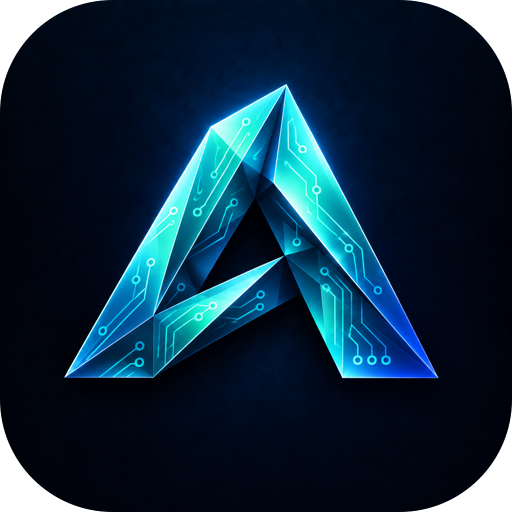
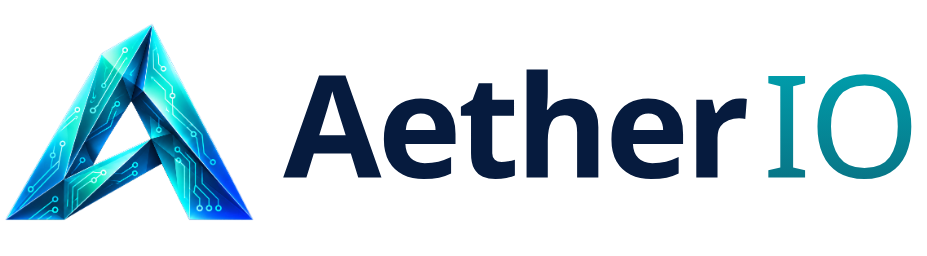
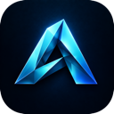

<!-- Product section generated by AetherStudio/dev/site/build_pages.py (apps.py). Edit there; developer notes below the line are kept. -->

> **Alpha 0.1:** [release setup, shared UI and current limitations](ALPHA_0_1.md). Fetch the checksum-locked vendor packages before installing dependencies.

<p align="center"></p>

<h1 align="center">
  <picture>
    <source media="(prefers-color-scheme: dark)" srcset="assets/branding/aether-io-wordmark-dark.png">
    
  </picture>
</h1>

<p align="center">Electronics and wiring for motion hardware.</p>

<p align="center">
  <a href="https://github.com/JenkinsRobotics/Aether-IO/releases/tag/v0.1.0-alpha.1"></a>
  
  <a href="https://jenkinsrobotics.github.io/Aether-IO/"></a>
</p>

Aether IO is where the electronics live: the controllers, signals, wiring and connections between your animation and real hardware. This alpha is an interface draft — the electrical engine comes next. Schematics, boards and harnesses for the machines you animate.

> **Alpha 0.1 — early access.** Aether IO is alpha software: features are incomplete,
> file formats may change between alphas, and it is not yet qualified for production
> work. Every feature below is marked as working today, in progress or planned.

## Features

### Works today

- ✅ **Interface draft** — Seven workspace routes on the shared Aether interface: schematic, board, simulation setup, 3D inspection, manufacturing preparation and more.
- ✅ **Agent pane** — Objects and checks on the left, the design in the centre, a conversation with your agent on the right.
- ✅ **Model Studio interface** — The shared Aether interface: a transparent document header, floating resizable side cards, a separate tool tray, saved layouts and themes — the same in every app.

### In progress

- 🔨 **Electrical document** — Symbol instances, pin maps, named nets, sheets, and separate schematic, board and assembly placement.

### Planned

- 🗺️ **Circuit simulation** — A validated solver for DC and transient results behind a product-owned boundary.
- 🗺️ **PCB layout** — Footprints, layers, copper routing, ERC/DRC and verified Gerber/drill output.
- 🗺️ **Firmware in the loop** — Compile and emulate supported microcontrollers against the same circuit.
- 🗺️ **Harness wiring** — Assembly modules, cable harnesses and 3D preview with Aether CAD.

## Built-in AI · Planned

Connect ChatGPT, Claude or Gemini once in Aether Studio (**Plugins → My connections**).
Agents use the app's own commands — validated, undoable and recorded. AI is optional:
nothing you save ever needs it.

- The workspace is designed around an agent conversation from the start; AI suggestions will remain editable inputs, never hidden results.
- The same tools are available from the command line and as MCP tools, with scoped permissions and safe retries.

Example: “Add a PCA9685 servo driver and wire channels 0–3 to the head servos.”

## On its own, or with Aether Studio

Aether IO keeps its core features on a single machine. Connect it to
[Aether Studio](https://jenkinsrobotics.github.io/AetherStudio/), your own server, and it gains what a
team needs: access from any device, built-in AI, PDM with versions, branches and
releases, and multi-user sharing, comments and tasks. Boards and harnesses will live in Drive next to the CAD parts and animations they connect.

## What every Aether app brings

- **Runs on its own.** Open an app on one machine and work locally. Your files stay on your disk in open, documented formats. _(local install today · downloadable desktop app planned)_
- **Or on your own server.** Point the apps at an Aether Studio server — a Mac Studio in the office or a rack of machines — and the whole team works from one place.
- **Any device.** Every app is a web app first, so laptops, desktops and tablets connect through a browser — no install on the client. _(desktop downloads planned)_
- **Built-in AI.** Connect ChatGPT, Claude or Gemini once in Studio. Each app's AI advisor edits your open document with the app's own tools — and AI is never required to open or play your work.
- **PDM and version control.** Versions, branches, releases and obsolescence for every document, with a visual version graph and restore.
- **Multi-user.** One account across every app, shared workspaces, permissions, comments and tasks. _(real-time co-editing in progress)_
- **Command line and MCP.** Every agent tool is also a CLI command and an MCP tool, with scoped grants, revision guards and retry receipts.
- **Open source.** Apache-2.0. Own your tools, your files and your server.

## Roadmap

| Release | Focus | What it means |
|---|---|---|
| Alpha 0.1 | Interface draft | The workspace and workflow, ready for review. |
| Alpha 0.2 | Electrical document | Nets, pins and sheets with save and exchange. |
| Beta | Simulate and lay out | Circuit simulation and PCB layout with design-rule checks. |

## Get started

```sh
git clone --branch v0.1.0-alpha.1 --single-branch https://github.com/JenkinsRobotics/Aether-IO.git
cd Aether-IO
python3 tools/fetch-vendor.py
```

See [Alpha 0.1 setup and current limits](ALPHA_0_1.md) for frontend build and
server requirements. The web download is a frontend bundle, not a desktop installer.

See the [website](https://jenkinsrobotics.github.io/Aether-IO/) for the full tour.

## The Aether apps

| | App | What it's for | Links |
|---|---|---|---|
|  | Aether CAD | 3D parametric parts, assemblies and production drawings. | [Site](https://jenkinsrobotics.github.io/Aether-CAD/) · [GitHub](https://github.com/JenkinsRobotics/Aether-CAD) |
|  | Aether Animation | Animate characters and animatronics, then play the motion on real servos. | [Site](https://jenkinsrobotics.github.io/Aether-Animation/) · [GitHub](https://github.com/JenkinsRobotics/Aether-Animation) |
|  | Aether Map | Projection mapping and unattended show playback on Raspberry Pi players. | [Site](https://jenkinsrobotics.github.io/Aether-Map/) · [GitHub](https://github.com/JenkinsRobotics/Aether-Map) |
|  | Aether Sketch | Drawing and sketching — clean vector paths today, expressive brushes next. | [Site](https://jenkinsrobotics.github.io/Aether-Sketch/) · [GitHub](https://github.com/JenkinsRobotics/Aether-Sketch) |
|  | **Aether IO** | **Electronics and wiring for motion hardware.** · you are here | [Site](https://jenkinsrobotics.github.io/Aether-IO/) · [GitHub](https://github.com/JenkinsRobotics/Aether-IO) |
|  | Aether Vector | Vector illustration and graphic design. | [Site](https://jenkinsrobotics.github.io/Aether-Vector/) · [GitHub](https://github.com/JenkinsRobotics/Aether-Vector) |
|  | Aether Studio | Your team's server: accounts, shared files, versions and live collaboration. | [Site](https://jenkinsrobotics.github.io/AetherStudio/) · [GitHub](https://github.com/JenkinsRobotics/AetherStudio) |

---

## Developer notes

## GitHub checkout handoff — 2026-10-10

Active development is now in `Aether-IO`. The existing app snapshot was
imported from `Temp Aether` into this GitHub-linked checkout. Source history and
original starter files are preserved there; this checkout keeps its GitHub
history and origin. No upload or running-installation cutover was performed.
Studio (server, Drive and shared packages) lives in `../AetherStudio`.
Earlier migration notes below describe historical folder names.

## Local repository handoff — 2026-10-09

This is the new local development home. The folder split, package boundaries,
setup/build integration and local Git history are complete. The original monorepo
remains the running deployment and historical backup. The GitHub origin is configured; see SOURCE_HISTORY.json.
See [development setup](../AetherStudio/LOCAL_DEVELOPMENT.md) and
[verification](../AetherStudio/migration/LOCAL_STRUCTURE_COMPLETE.md).
The earlier extraction notes below describe the initial snapshot.

# aether-io

Local migration candidate for Aether. Extracted from the current working source,
including uncommitted changes. **Production still uses the original Aether Studio
checkout.** Read `MIGRATION.md` before switching development to this folder.

## Build

Use Node 22.12+ and npm. From `.`:

```sh
npm ci
npm run build
```

Shared Aether packages are versioned archives under `vendor/`, with lockfile
integrity checks. No frontend imports source from the original checkout. Archives
are temporary local distribution until the package registry is configured.
The platform serves these builds using `aether-platform/projects.json`.

The existing product README is retained as `README.pre-split.md` where present.
Some older paths in historical documentation refer to the former monorepo.
